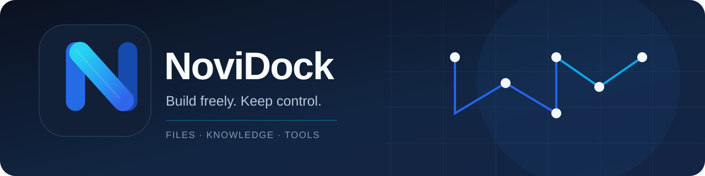

**让工具更自由，让数据留在自己手中。**

Open-source tools for files, knowledge and workflows — built with control and portability in mind.

[Explore NoviDock](https://github.com/NoviDock/NoviDock) · [Explore NoviDock-Core](https://github.com/NoviDock/NoviDock-Core)

---

### Our work · 开源项目

| [NoviDock](https://github.com/NoviDock/NoviDock) | [NoviDock-Core](https://github.com/NoviDock/NoviDock-Core) |
| :--- | :--- |
| **完整产品入口**：Web、Desktop、CLI 逐步整合，当前仓主要是浏览器体验原型 | **开发基础**：Rust Core、文件与知识能力、实验性加密兼容；目前还包含迁移中的桌面端和 CLI |
| User-facing product and experiences | Rust foundation and reusable capabilities |

### Principles · 我们的原则

- **Useful first** · 实用优先，解决实际问题
- **Local first** · 本地优先，用户掌握文件与权限
- **One foundation** · 统一核心能力，避免重复实现
- **Evidence matters** · 区分已发布、开发预览与仍在验证的功能

### Current status · 当前阶段

NoviDock 正在逐步从早期 KnowKit 原型迁移到 Rust-first 架构。浏览器体验可用源码部署，Core 仓已有 Rust Core、CLI 与 Tauri 桌面端开发预览；桌面安装包和加密安全审计尚未完成。

We do not claim that experimental cryptography, untested platforms, or unreleased installers are production ready.

---

**Build freely. Keep control.**

[Product](https://github.com/NoviDock/NoviDock) · [Core](https://github.com/NoviDock/NoviDock-Core)

